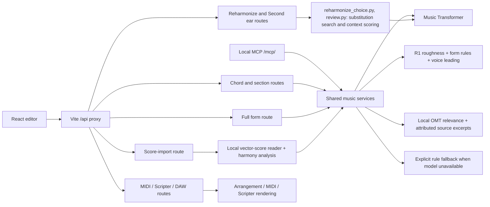

# TheArtist — API Specification

> Shared arrangement contracts for the editor, TheVoyager, and future plugin clients

The API supports an [arrangement workflow](README.md#compose-arrange-export): import
harmonic material, develop form, compare substitutions and render editable
accompaniment. Chord-generation endpoints supply one part of that workflow.
Every model call goes to a TheArtist Music Transformer checkpoint. Accompaniment
patterns, voicings and MIDI rendering use application code.

---

## Architecture Overview



Score import, planning, review, export and MCP use the same backend services. Local OMT retrieval is enabled by default after corpus setup, and Berklee is independently disabled. The old embedding and explanation models are not used. MCP is not mounted on public hosts. There is no generic `POST /api/export` endpoint.

## Base URL

```
Development: http://localhost:8000/api
Hosted editor: https://artist.pearlleestudio.co/api
Shared model API: https://music-api.pearlleestudio.co/api
```

Vite dev server proxies `/api` → `http://localhost:8000/api` (configured in `vite.config.ts`).

---

## Endpoints

| Endpoint | Contract |
|---|---|
| `POST /api/import/score` | Attached vector PDF → locally read harmony draft for review, with Music Transformer proposals for sparse note-bearing bars |
| `POST /api/import/score/stream` | Same body; SSE `progress` frames, then exactly one `result` (the import JSON) or `error` `{detail, status}` |
| `POST /api/reharmonize` | Existing selected harmony → three bounded substitution patches, up to 1–4 changed chords each |
| `POST /api/review/candidates` | A Generate's A/B/C → the candidate with the highest conditional chord likelihood under the selected checkpoint, with separately measured theory facts |
| `POST /api/export/midi` | Edited `ExportSpec` → `audio/midi` bytes |
| `POST /api/export/scripter` | The same `ExportSpec` → a Logic Pro Scripter script |
| `GET /api/daw/targets` | Installed Logic/Ableton availability on the backend machine |
| `POST /api/daw/open` | Explicit local file output and Logic open / Ableton reveal |
| `GET /api/capabilities` | Versioned service/tool discovery |
| `/mcp/` | Streamable HTTP MCP; shared generation, import and export services ([MCP contract](backend/app/mcp_server.py)) |

Generation, planning and model endpoints are specified below with these routes. PDF export is rendered in the browser and has no REST endpoint.

### GET `/api/health`

Health check. Returns `{ "status": "ok" }`.

### POST `/api/generate`

Generate chord suggestions for selected measures. Used by the frontend chord editor.

**Status:** Implemented — AI inference (Music Transformer) with rule-based fallback.

**Request:**

```json
{
  "key": "G major",
  "bpm": 80,
  "genre": "jazz",
  "modelKey": "ft_f4",
  "timeSignature": [4, 4],
  "context": [
    { "measure": 0, "chords": ["Gmaj7", "Em7"] },
    { "measure": 1, "chords": ["Am7", "D7"] },
    { "measure": 2, "chords": [null, null] },
    { "measure": 3, "chords": [null, null] }
  ],
  "selectedMeasures": [2, 3],
  "sectionType": "verse"
}
```

| Field | Type | Description |
|-------|------|-------------|
| `key` | `string` | Key signature, e.g. `"C major"`, `"A minor"` |
| `bpm` | `number` | Tempo (20-300) |
| `genre` | `string \| null` | Genre hint — any key of the 13-genre vocabulary: `"jazz"`, `"pop"`, `"rock"`, `"blues"`, `"bossa"`, `"classical"`, `"country"`, `"rnb_soul"`, `"hip_hop"`, `"electronic"`, `"funk"`, `"folk"`, `"gospel"` — or `null` |
| `modelKey` | `string \| null` | Checkpoint to use: `"phase0"`, `"ft_f1"`…`"ft_f5"`, `"ft_f1_v2"`, or `"ft_f1_lora_<genre>"` (R4 LoRA adapters). Default `null`, which dispatches by `genre` through `GENRE_MODEL_DISPATCH` and uses `ft_f1` when there is no genre. See [Model Checkpoints](#model-checkpoints). |
| `timeSignature` | `[number, number]` | e.g. `[4, 4]`, `[3, 4]`, `[6, 8]` |
| `context` | `ContextMeasure[]` | All measures in the song with existing chords |
| `selectedMeasures` | `number[]` | Indices of measures to generate chords for (1-64; more → 400) |
| `sectionType` | `string \| null` | Any of the 17 [song-form section](#song-form-sections) ids, or `null` for no song-form rules. The backend never guesses it. The editor's Auto sends the section that holds the selected bars, else the part the bars' place in the whole song suggests (`frontend/src/engine/songForm.ts`, `autoSection`), or `null` when they cross a section boundary. Unknown ids → 400. |

**Response (200):**

```json
{
  "suggestions": [
    {
      "label": "Option A — F4 — 1K pop mix (conservative)",
      "chords": {
        "2": ["Bm7", "E7"],
        "3": ["Am7", "D7"]
      },
      "explanations": null
    },
    {
      "label": "Option B — F4 — 1K pop mix (balanced)",
      "chords": {
        "2": ["Bm7", "Ab7"],
        "3": ["Am7", "Ab7"]
      },
      "explanations": null
    },
    {
      "label": "Option C — F4 — 1K pop mix (creative)",
      "chords": {
        "2": ["Bbmaj7", "Eb7"],
        "3": ["Am7", "Dm7"]
      },
      "explanations": null
    }
  ],
  "source": "ai"
}
```

| Field | Type | Description |
|-------|------|-------------|
| `suggestions` | `Suggestion[]` | 1-3 chord progression options (one per temperature pass; the rule fallback always returns 3) |
| `suggestions[].label` | `string` | Human-readable description of harmonic approach |
| `suggestions[].chords` | `Record<string, [string, string]>` | Measure index → 2 chord names (slot 0, slot 1) |
| `suggestions[].explanations` | `TheoryExplanation[] \| null` | Up to 16 distinct transition references per candidate from enabled, ready sources; `null` when unavailable/disabled. Each: `{chord_a, chord_b, concept, explanation, chapter, section, page_start, page_end, kind, citation}`. Product `kind` is `source_excerpt`; `explanation` is a source excerpt of at most 400 characters, not generated analysis. `citation` contains source, title, URL, authors, editors, license, license URL, copyright, changes and passage ID. Web sources have page numbers 0. |
| `source` | `"ai" \| "rules"` | Which generator produced the suggestions (`"rules"` = rule-based fallback fired). |

**Error (4xx):**

```json
{
  "detail": "Expected key format: 'C major' or 'A minor'"
}
```

400 = bad key format, no measures selected, more than 64 measures selected, or an unknown `sectionType`. Body-schema violations (e.g. `bpm` outside 20-300) are rejected by FastAPI with 422.

**Current strategies (rule-based fallback):**
1. **Diatonic ii-V** — weighted diatonic chord selection, ending with ii-V targeting I
2. **Tritone substitution** — ii → bII7 instead of ii → V7
3. **Modal interchange** — borrow chords from parallel major/minor

---

### POST `/api/generate/stream`

Streaming variant of `/api/generate` — **the frontend's primary generate path** (`frontend/src/engine/chordGenerator.ts` calls this to drive the live progress UI; plain `/api/generate` remains the non-streaming equivalent for programmatic callers).

**Status:** Implemented — same request body and validation as `/api/generate`. Response is `text/event-stream` (SSE; served with `X-Accel-Buffering: no` + `Cache-Control: no-cache` so frames are not proxy-buffered).

**Request:** identical to `/api/generate`.

**SSE frames** (event name = inference pipeline phase; one frame per event, except that `ranking` can appear twice — see `backend/app/routes/generate.py` + `app/services/inference.py`):

| Event | Payload | When |
|-------|---------|------|
| `model_load` | `{"label": "Loading <model label>"}` | Only when the checkpoint is cold (first request after startup / model switch). |
| `composing` | `{"label", "step", "total", "creativity"}` | ×3 — one per temperature pass; `step` 1-3, `total` 3, `creativity` ∈ `conservative` (0.7) / `balanced` (0.9) / `creative` (1.1). When `context` holds chords in unselected measures after the selection, each temperature writes `THEARTIST_CONTEXT_DRAWS` drafts (default 4, 1 to 8, and at most 64 ÷ selected bars) and keeps the one under which those chords are likeliest, judged with the key anchor and the song-form rules applied; the label then ends with `: <n> drafts, keeping the one that leads best into the written bars after it`. One draft is written when those chords cannot be scored (a chord outside the vocabulary, or none inside the model window); the closing whole-score comparison then reports the reason. If a choice still fails, a second `composing` frame for that step says the first draft was kept. |
| `ranking` | `{"label": "Scoring consonance and theory relevance"}` | R1 roughness + ready-source text relevance; label is `Scoring consonance` when no source is ready. |
| `voicing` | `{"label": "Picking inversions for smooth bass motion"}` | Unless disabled via `THEARTIST_DISABLE_VOICE_LEADING`. |
| `ranking` (second frame) | `{"label": "Compared candidates with preceding and following chords"}`, `{"label": "Compared candidates with the <n> bars before and after the passage"}` when the whole score exceeds the checkpoint's token window and the nearest `n` bars on each side were compared instead, or `{"label": "<reason> Whole-score comparison was skipped."}` when not even the neighbouring bars fit or a context chord is outside the vocabulary | Only when `context` holds chords in unselected measures after the selection: the candidates are re-ordered and re-lettered A/B/C by their likelihood in context under the checkpoint (`app/services/chord_context.py`); the list order is the ranking. |
| `explaining` | `{"label": "Retrieving related theory references"}` | Only when an enabled corpus is ready and explanation output is enabled; all genres may retrieve related references. |
| `complete` | `{"label": "Done"}` | Right before `result`. |
| `result` | Same payload shape as `/api/generate`'s 200 JSON (`{suggestions, source}`) plus `elapsed_ms` | Final frame, then the stream closes. |
| `error` | `{"detail": "..."}` | Terminal — the 400 validation errors of `/api/generate` are streamed as an `error` frame instead of an HTTP 4xx; a failure inside generation ends the stream with `{"detail": "Chord generation failed"}`. |

Every stream ends with exactly one terminal frame (`result` or `error`); phase frames carry `t_ms` (ms since the request started). Body-schema violations (e.g. `bpm` outside 20-300) are still rejected with HTTP 422 JSON before any stream starts.

If torch is unavailable, no phase frames fire — the rule-based fallback runs and only the `result` frame arrives, with `"source": "rules"`. If torch is present but the checkpoint has not been downloaded, a `model_load` frame fires first (the registry attempts the load), then the load fails and the same rule-based `result` arrives.

---

### POST `/api/generate/section`

Compose one song-form section (an 8-bar chorus, a 4-chord turnaround, …) after the measures already in the song. The section's measures are appended after `context`, so the suggestion keys are absolute measure indices.

**Status:** Implemented — same AI pipeline as `/api/generate` with the section's song-form rules, plus key anchoring for a section with no chords before it; rule-based fallback.

**Request:**

```json
{
  "key": "C major",
  "bpm": 96,
  "genre": "pop",
  "timeSignature": [4, 4],
  "sectionType": "chorus",
  "chordCount": 16,
  "context": [
    { "measure": 0, "chords": ["Cmaj7", "Am7"] },
    { "measure": 1, "chords": ["Dm7", "G7"] }
  ],
  "modelKey": null
}
```

| Field | Type | Description |
|-------|------|-------------|
| `key` | `string` | Same format as `/api/generate` (`"C major"`, `"A minor"`) |
| `bpm` | `number` | Tempo (20-300). Default `80` |
| `genre` | `string \| null` | Same 13-genre vocabulary as `/api/generate`. Default `null` |
| `timeSignature` | `[number, number]` | Default `[4, 4]` |
| `sectionType` | `string` | Required. One of the 17 [song-form section](#song-form-sections) ids |
| `chordCount` | `number` | Required, 2-128. Two chord slots per measure, so the section spans `ceil(chordCount / 2)` bars (an odd count rounds up) |
| `context` | `ContextMeasure[]` | The measures that come **before** the new section, indices `0..k-1` in order. Default `[]` (a fresh section) |
| `modelKey` | `string \| null` | Same checkpoint keys as `/api/generate`. Default `null` = genre dispatch |
| `seed` | `int \| null` | Optional strict integer `0..4294967295`; request-local candidate sampling, including rule fallback. Default `null` remains stochastic |
| `cadence` | `string \| null` | `authentic`, `plagal`, `half`, `half_iv_v`, `turnaround`, or `none`; overrides the section's default ending. Null keeps that default |

**Response (200):**

```json
{
  "sectionType": "chorus",
  "title": "Chorus — 8 bars",
  "startMeasure": 2,
  "bars": 8,
  "chordCount": 16,
  "suggestions": [
    {
      "label": "Option A — F1 — 10K pop mix (conservative)",
      "chords": {
        "2": ["Am", "Gmaj"],
        "3": ["Fmaj", "Emaj"],
        ...
        "9": ["G7/D", "Cmaj"]
      },
      "explanations": null
    },
    ...
  ],
  "source": "ai",
  "modelUsed": "ft_f1"
}
```

| Field | Type | Description |
|-------|------|-------------|
| `sectionType` | `string` | Echoes the request |
| `title` | `string` | Default title for a single section: `"{Label} — {bars} bars"` (em dash, `bar` when 1), e.g. `"Chorus — 8 bars"` |
| `startMeasure` | `number` | `= len(context)` — absolute index of the section's first measure |
| `bars` | `number` | `= ceil(chordCount / 2)` |
| `chordCount` | `number` | `= bars * 2` |
| `suggestions` | `Suggestion[]` | Usually 3 (A/B/C), same shape as `/api/generate`. Each has exactly `bars` keys: `str(startMeasure)` … `str(startMeasure + bars - 1)`, each with 2 chords |
| `source` | `"ai" \| "rules"` | `"rules"` = the model was unavailable and the rule-based generator answered |
| `modelUsed` | `string \| null` | Checkpoint key that actually produced the chords when `source` is `"ai"` (a LoRA key that fell back to the F1 base reports `ft_f1`); `null` for rules |

**Errors:**

| Status | Body | When |
|---|---|---|
| 400 | `{"detail": "Expected key format: 'C major' or 'A minor'"}` | Bad key format. |
| 422 | Pydantic validation | Unknown or missing `sectionType`, `chordCount` outside 2-128, `bpm` outside 20-300, a seed other than null or an unsigned 32-bit JSON integer, or another body-schema violation. |

Seeded section requests own their sampling state; they do not reseed process-wide
randomness. Booleans, numeric strings and fractional seeds are rejected.
Reproduction requires the same checkpoint, runtime, device and request parameters.
The section response does not echo the seed; preserve the request for reproduction.

**Internal flow:**
1. `context` + one empty row per new bar (indices from `len(context)`); the new indices are the selection.
2. AI (torch + checkpoint available): resolve the checkpoint exactly like `/api/generate` → sample 3 candidates → **key anchor** (only when no chord precedes the section) → rerank → song-form rules for `sectionType` → voice-leading inversions (a section whose rule resolves to the tonic — verse, chorus, outro, tag, head, A section — keeps a root-position final tonic) → attributed theory excerpts. Song form runs before voice leading and explanations, so slash basses and theory notes describe the final chords.
3. Rules fallback: `generate_suggestions` with a position derived from the section (intro 0.0, verse 0.25, pre_chorus 0.4, chorus 0.6, post_chorus 0.65, bridge 0.7, outro 1.0, others 0.5), then the same song-form rules.

**Key anchoring** (`app/services/key_anchor.py`): with no chords to continue from, the model largely ignores the `[KEY:…]` token (a fresh "C major" pop request can come back in E major). Each candidate's diatonic collection is estimated by counting its chord tones inside each of the 12 major-scale collections (relative major and minor are the same collection); when the best collection beats the requested key's by at least 5% of all chord tones (and at least 2 tones), every chord — root and slash bass — is transposed by the interval between the two collections' tonics and spelled for the requested key (sharps for G D A E B major, E B minor and any key named with a `#`; flats for flat keys and C major / A minor). Rock and blues progressions centre on their collection's 5th degree instead (C–Bb–F or C7–F7–G7 sits in F major's collection): a candidate that opens on that degree and either closes on it or lands on it more often than on the collection's tonic is transposed so that this centre falls on the requested tonic — an E blues asked for in C major comes back as a C blues, not a G blues, and a C blues asked for in C major stays as it is. Such a result is spelled like the major key on the requested tonic (`F#m`, not `Gbm`, for A minor). Ties and near-ties keep the model's chords; a candidate is never moved when the section follows chords the model could continue from.

---

### POST `/api/generate/section/stream`

Streaming variant of `/api/generate/section`. Same request body and validation; response is `text/event-stream` with the same headers as `/api/generate/stream`.

**SSE frames:** the same phase frames as [`/api/generate/stream`](#post-apigeneratestream) (`model_load`, `composing` ×3, `ranking`, `voicing`, `explaining`, `complete`; each data object has `label` plus `t_ms`), then exactly one terminal frame:

| Event | Payload | When |
|-------|---------|------|
| `result` | The `/api/generate/section` 200 JSON plus `elapsed_ms` | Generation finished (AI or rules). |
| `error` | `{"detail": "..."}` | Bad key format (streamed instead of a 400), or a failure inside generation. |

Body-schema violations are HTTP 422 JSON before the stream starts, exactly like the JSON route, so a client must handle a non-2xx response from this route too.

---

### Song-form sections

One vocabulary for `sectionType` on every route. Canonical list: `backend/app/models/sections.py` (mirrored in `frontend/src/engine/songForm.ts`). Two chord slots per measure; `bars = ceil(chordCount / 2)`; at most 128 chords = 64 bars on every path. The rules live in `backend/app/services/song_form.py`; each keeps the chord count unchanged, and roman numerals are relative to the request key (minor keys use i / iv / V7).

| id | Label | Group | Default chords | Song-form rule |
|----|-------|-------|----------------|----------------|
| `intro` | Intro | common | 8 | Starts on I |
| `verse` | Verse | common | 16 | Ends V7 → I |
| `pre_chorus` | Pre-Chorus | common | 8 | Ends on V7 (half cadence) |
| `chorus` | Chorus | common | 16 | Ends V7 → I |
| `post_chorus` | Post-Chorus | common | 8 | Static loop: repeats its first 2 bars, no cadence |
| `bridge` | Bridge | common | 16 | Starts on IV, ends IV → V7 |
| `outro` | Outro | common | 8 | Ends IV → I (plagal) |
| `interlude` | Interlude | instrumental | 8 | None (the model's phrase) |
| `solo` | Solo | instrumental | 16 | None |
| `breakdown` | Breakdown | instrumental | 16 | Static: repeats its first bar |
| `drop` | Drop | instrumental | 16 | Static loop: repeats its first 2 bars |
| `vamp` | Vamp | instrumental | 4 | Static: repeats its first bar |
| `turnaround` | Turnaround | instrumental | 4 | Last 4 chords I – vi – ii – V7 (minor: i – VI – iiø – V7); under 4 chords just ends on V7 |
| `tag` | Tag | instrumental | 8 | Ends V7 → I, like an outro's close |
| `head` | Head | jazz | 64 | Ends V7 → I |
| `a_section` | A Section | jazz | 16 | Ends V7 → I |
| `b_section` | B Section | jazz | 16 | Starts on IV, ends IV → V7 |

A rule that ends on I writes a bare tonic triad (`Cmaj` / `Amin`), and voice leading leaves it in root position; other chords may still receive slash-bass inversions.

Chords a rule writes are spelled for the key. The five original sections (intro, verse, chorus, bridge, outro) keep their original spelling, flats except in B, F# and C#. The other sections follow the key signature like key anchoring, so an E major turnaround ends `Emaj7 – C#m7 – F#m7 – B7` and an E minor one `Em7 – Cmaj7 – F#m7b5 – B7`, while F major and D minor keep flats.

---

### POST `/api/plan/song` and `/api/plan/song/stream`: complete the form

The Full form run lays out the rest of a song form on the genre's template after
the user's sketch, checks the plan with `validate_plan`, and generates every
planned section with the selected Music Transformer (the same service as
`/api/generate/section`, with the planned `cadence`). Optional chorus reuse retains
an existing same-length progression. The API is stateless: nothing is applied
server-side, and the client applies the returned sections.

Request (`PlanRequest`, strict):

| Field | Meaning |
|---|---|
| `genre` | One of the 13 genres. Its defaults fill `key`, `bpm` and `timeSignature` when they are omitted |
| `key`, `timeSignature`, `bpm` | The song's one key (fixed for every section), meter and tempo |
| `measures` | The whole sketch: `[{index, chords: [symbol\|null, symbol\|null], roman: [string\|null, string\|null]}]`. The Roman numerals come from the frontend's `romanNumeral.ts`, and `validate_plan` checks a plan's `cites` against them |
| `sections` | Existing sections `[{type\|null, start, length, label?}]`. They are locked, and the plan only adds sections after the sketch |
| `targetBars` | 16, 32, 48 or 64, sketch included |
| `wantOutro`, `contrast` | Chips: an outro is required or forbidden (default `false`). `contrast` (`low`, `medium`, `high`; default `medium`) is accepted and has no effect |
| `modelKey` | Checkpoint for every section, as `SectionGenerateRequest.modelKey` |
| `seed` | Optional strict integer `0..4294967295`, default null. Controls chord sampling |
| `chorusMode` | `new` (API default) or `reuse`. The form UI defaults to **Keep the theme** (`reuse`) and also offers **New progression** |

A body that breaks the schema is rejected with 422 before a run starts, such as an
unknown field or genre, measures that are not the whole sketch indexed `0..n-1` in
order, a `targetBars` that leaves fewer than 2 bars after the sketch, or sections
that overlap, are out of order or leave the sketch. Since 2026-11-10 the fields
`planner` and `chordSource` are not accepted: a request that carries either is
rejected with 422, and the MCP tools `plan_song` and `validate_plan` refuse it as a
tool error (`isError: true`).

The template is the genre's default form (`RULES_FORMS` in
`backend/app/services/planner.py`, with pop's form for genres that have none),
without its intro when the sketch already opened the song, fitted to the bars left
before `targetBars`, plus a four-bar outro when `wantOutro` is set. Each section gets
its type's default cadence, the last section ends `authentic` (`plagal` for an
outro), and `reason` reads `<genre> default form (rules)` with no `cites`.

Plan shape: `{sections: [{type, bars, cadence, reason, cites: [{bar, roman}]}]}` with
`cadence` in `authentic`, `plagal`, `half`, `half_iv_v`, `turnaround`, `none`.
`validate_plan` rules: section vocabulary, 2 to 32 bars per section, sketch bars
plus planned bars equal `targetBars`, intro only first (empty sketch) and outro only
last, the last cadence authentic or plagal, `wantOutro` honoured, every cite's bar
exists in the sketch with that Roman numeral, and `reason` at most 120 characters.

Response (`PlanTrace`): `status` (`ok` or `error`), `genre`, `key`, `bpm`,
`timeSignature`, `plan` (`null` only when a run stops before planning),
`validation: [{attempt, ok, errors: [{code, section, message}]}]` (one attempt, the
check of the template plan), `sections`, `elapsedMs`, `generationMs` (wall clock
inside the chord model) and `error`, which is `null` or on failure `{kind, message}`
with `kind` in `timeout`, `invalid`, `generation`. Each entry of `sections` is a
`SectionGenerateResponse` plus `cadence`, `rulesSlots` (section-relative chord slots
the song-form rules decided, never counted as the model's), `reason`, `cites`,
`regenerated` (`false` in every run) and `reuse`. A run has 120 s of wall clock,
45 s of it inside the chord model. Both limits are checked before a section starts,
and the trace of a failed run keeps the plan and the sections generated before the
failure.

With `chorusMode: reuse`, the first complete same-length chorus in the locked sketch
is preferred, otherwise the first generated chorus. Incomplete or unsupported chords
and different lengths are not reused. Only the planned cadence can change slots.
Such a `PlanSectionResult` extends the section response with `source: reuse`,
`modelUsed: null`, and `reuse: {origin: sketch|section, sectionIndex: number|null,
startMeasure, source: sketch|ai|rules, modelUsed: string|null, retainedSlots,
changedSlots}`. Slot lists are relative to the reused section. Normal sections
have `reuse: null`.

The JSON route answers the trace of a completed run with 200 and the trace of a
failed run under the failure's status: 504 when the run passes a time budget
(`timeout`), 502 when the template plan fails validation (`invalid`) and 500 for a
generation failure (`generation`).

The stream variant answers 200 and sends SSE events, each with `t_ms`: `progress`
(`{label}`, before planning and before each section), `plan`
(`{attempt: 1, source: "rules", plan}`), `validate` (`{attempt: 1, ok, errors}`) and
one `generate_section` per section in plan order (`index` plus that section's
fields). A comment keep-alive line (`: composing song form`) is sent every 5 s while
the worker is busy. The stream ends with one `complete` or `error` frame carrying
the whole trace while the client remains connected, or with `error`
`{"detail": "Song planning failed"}` when the worker itself fails. The MCP tools
`plan_song` (plan and validate, no generation) and `validate_plan` share this
service.

On a stream disconnect, the worker stops before the next section begins.
Cancellation does not apply partial sections. The editor ignores late responses,
and refuses Apply if the request's musical sketch or settings changed.

With a plan seed, zero-based planned section `i` receives
`(seed + i * 1009) mod 2^32`, which isolates the sampling of each section. The
request must be retained with the trace for reproduction.

---

### POST `/api/reharmonize` — Contextual harmonic alternatives

Return three substitution candidates for existing selected chords. The request
is read-only; only a subsequent editor action applies a candidate. Each patch
proposes bounded edits within the selection and leaves empty slots untouched.

```json
{
  "key": "C major",
  "timeSignature": [4, 4],
  "context": [
    {"measure": 0, "chords": ["Cmaj7", "Am7"]},
    {"measure": 1, "chords": ["Dm7", "G7"]},
    {"measure": 2, "chords": ["Cmaj7", null]}
  ],
  "selectedSlots": [
    {"measureIndex": 0, "slotIndex": 0},
    {"measureIndex": 0, "slotIndex": 1},
    {"measureIndex": 1, "slotIndex": 0},
    {"measureIndex": 1, "slotIndex": 1}
  ],
  "maxChanges": 4,
  "mode": "auto",
  "modelKey": "ft_f1"
}
```

Context contains 1–512 consecutive, unique measures with their zero-based score
numbers (any window of a longer score; it need not start at 0), each with exactly
two chord slots. `selectedSlots` contains 1–16 unique occupied slots spanning at
most eight measures, all inside the context. The browser omits empty slots from its selection request.
`maxChanges` is `1 | 2 | 3 | 4` (default 1), an upper bound per candidate; it does
not request four alternatives or require exactly four edits. Supported meters
are 4/4, 3/4, 6/8, 2/4 and 5/4. `mode` defaults to `auto`; explicit `ionian`,
`dorian`, `phrygian`, `lydian`, `mixolydian`, `aeolian` or `locrian` constrains
each proposed chord to the corresponding parallel scale.

`ReharmResponse` contains three `candidates`, `modelUsed` (the scoring checkpoint's
label), `contextMeasures` (the measures the checkpoint scored, from eight before the
first selected measure to eight after the last) and `modelApproximations`.
Each candidate has an `id`, search `family`, and `changes` containing an address,
`before`/`after` symbols, shared-tone count, compatible modes and verified
convention labels. Candidate metrics include pitch distance, bass motion,
mathematical score, convention score and learned `modelScore`. These metrics
are not probabilities of musical quality. Model-vocabulary approximations are
reported separately and never applied as score edits.

Invalid input, an unknown or unavailable checkpoint, and fewer than three distinct
candidates are 422 errors, and no fallback candidates are returned. How the three
substitution families are searched, scored in context and chosen is described in
[Reharmonize](backend/app/services/reharmonize.py).

### POST `/api/review/candidates`: Second ear

Second ear compares a Generate's two or three candidates under the selected Music
Transformer and reports theory facts that code measured separately. Nothing is
applied: adopting a candidate stays the user's click.

Request (`ReviewRequest`, strict, HTTP 422 before any fact is computed):

| Field | Meaning |
|---|---|
| `key` | The song's key, `C major` or `A minor` |
| `modelKey` | The checkpoint that scores the candidates, default `ft_f1` |
| `timeSignature` | The song's meter, default `[4, 4]`; one of 4/4, 3/4, 6/8, 2/4 and 5/4 |
| `genre` | One of the 13 genres, or `null` |
| `sectionType` | The section Generate used, whose song-form rules wrote some slots. `null` means no rules |
| `original` | The bars before the generation: per measure two slots, a symbol or `null` (1 to 64 measures) |
| `candidates` | 2 or 3 `{label, chords}` over the same measures, every slot as Apply would write it, with unique labels |
| `previousSection` | The section before the bars' section, from the same offset, used as preceding context. `null` when there is none |

Facts per candidate: `modelScore` (the candidate's conditional chord likelihood
under the checkpoint, in context after `previousSection`, rounded to five decimals),
and over its filled slots `outOfKeyRatio` (chords with a tone outside the key),
`changedSlots` (slots that differ from `original`), `repetitionVsPrevious` (chords
equal to the previous section's at that slot), `r1Roughness` (mean Sethares
roughness per chord, as the R1 rerank computes it, with flat roots respelled for
music21) and `rulesSlots` (slots the song-form rules write, context only).

Response (`ReviewResponse`): `choice` is the label of the candidate with the highest
`modelScore`. `reasons` holds one entry: `fact: "modelScore=<value>"`,
`factName: "modelScore"`, `value` and `analyzerValue` (both that score),
`confirmed: true` and the claim "Highest conditional chord likelihood among these
candidates; not a quality rating." The response also has `facts` (one row per
candidate, in request order), `model` (the checkpoint's label) and `latencyMs`.
An unknown or unavailable checkpoint is a 422.

### POST `/api/generate/chords`

Simplified chord-generation endpoint for **programmatic callers** (TheVoyager and similar). Returns a flat list of bars instead of measure-keyed suggestions.

**Status:** Implemented — same Music Transformer checkpoints and tokenizer as `/api/generate`, but raw sampling only (no genre dispatch, key anchoring, R1/R2 rerank, song-form rules or voice leading); rule-based fallback.

**Request:**

```json
{
  "key": "A minor",
  "genre": "jazz",
  "time_signature": [4, 4],
  "bpm": 110,
  "n_bars": 8,
  "context_bars": null,
  "temperature": 0.8,
  "model": "ft_f4",
  "n_candidates": 1
}
```

| Field | Type | Description |
|-------|------|-------------|
| `key` | `string` | Same format as `/api/generate` |
| `genre` | `string \| null` | Genre hint. 13-genre vocab: `jazz`, `pop`, `rock`, `blues`, `bossa`, `classical`, `country`, `rnb_soul`, `hip_hop`, `electronic`, `funk`, `folk`, `gospel` (alias: `bossa nova` → `bossa`). The serving tokenizer is the extended 359-vocab with a `[GENRE:<name>]` token per genre; genres outside the vocab fall through to unconditioned (`[GENRE:none]`). |
| `time_signature` | `[number, number]` | Default `[4, 4]` |
| `bpm` | `number \| null` | Optional BPM hint (20-300). Currently echoed in response; not encoded into the prompt (the trained tokenizer has no BPM-bucket tokens). Reserved for a future training round. |
| `n_bars` | `number` | Number of bars to generate (1-32). Default `4` |
| `context_bars` | `string[][] \| null` | Optional preceding bars, e.g. `[["Cmaj7","Am7"],["Dm7","G7"]]` |
| `temperature` | `number` | Sampling temperature (0.1-2.0). Default `0.8` |
| `model` | `string` | Same checkpoint keys as `modelKey` above (`phase0` / `ft_f1`...`ft_f5` / `ft_f1_v2` / `ft_f1_lora_<genre>`). Defaults to `ft_f1` if omitted. |
| `n_candidates` | `number` | Default `1`. Range `1-5`. When `>1`, multiple chord progression candidates are returned with varied temperature for diversity. Response shape branches on this field (see below). |

**Response (200) — when `n_candidates=1` (default, backward-compat):**

```json
{
  "bars": [
    {"chords": ["Am7", "Fmaj7"]},
    {"chords": ["Cmaj7", "G7"]}
  ],
  "key": "A minor",
  "genre": "jazz",
  "bpm": 110,
  "model_used": "ft_f4"
}
```

**Response (200) — when `n_candidates > 1`:**

```json
{
  "candidates": [
    {"bars": [{"chords": ["Am7", "Fmaj7"]}, ...], "temperature": 0.6, "seed": null},
    {"bars": [{"chords": ["Am", "F"]}, ...],     "temperature": 0.8, "seed": null},
    {"bars": [{"chords": ["Am7", "Dm7"]}, ...], "temperature": 1.0, "seed": null}
  ],
  "key": "A minor",
  "genre": "jazz",
  "bpm": 110,
  "model_used": "ft_f4"
}
```

`model_used` echoes the requested `model` when a checkpoint generated the chords, even when a LoRA adapter directory is missing and the F1 base served the request, and is `"rules"` when the rule fallback answered. `bpm` echoes the request value (`null` if not provided). `temperature` per candidate is the actual temperature used for sampling (spread around `req.temperature` for diversity); when `model_used` is `"rules"` it is only the planned spread value, and the rules path yields at most three distinct candidates and repeats the first beyond that. `seed` is `null` (reserved for deterministic sampling).

**Errors:**

| Status | Body | When |
|---|---|---|
| 400 | `{"detail": "Expected key format: 'C major' or 'A minor'"}` | Bad key format: the same root and mode check as `/api/generate`, applied before any model is loaded on both the AI and the rules path. |

---

### Model Checkpoints

`modelKey` (and `model` on `/api/generate/chords`) selects from the paper experiment checkpoints in `ai/checkpoints/` (gitignored — fetch from HuggingFace with `uv run --with huggingface_hub python model/_download.py`. Without them, every key falls through to rule-based generation):

| Key | Checkpoint dir | Description |
|-----|---------------|-------------|
| `phase0` | `phase0_pop_baseline` | Pop pretrain baseline (no jazz fine-tune) |
| `ft_f1` | `ft_jazz_pop80` | F1, jazz + 10K pop mix. The released weights equal Phase 0 ([models](model/README.md)) |
| `ft_f1_v2` | `ft_jazz_pop80_v2` | F1 v2 — selection-corrected retrain (best checkpoint chosen on jazz-only val; hash-distinct from Phase 0). Standalone key; LoRA adapters keep pairing with `ft_f1`. |
| `ft_f2` | `ft_jazz_pop67` | F2 — 5K pop mix |
| `ft_f3` | `ft_jazz_pop50` | F3, jazz + 2.5K pop mix |
| `ft_f4` | `ft_jazz_pop29` | F4, jazz + 1K pop mix (genre dispatch for jazz) |
| `ft_f5` | `ft_jazz_only` | F5 — jazz only |

For `/api/generate`, `/api/generate/section` and their stream variants, a `modelKey` from the table or the LoRA list below is used as given. A `null` or unknown `modelKey` is not an error. With a `genre` it routes through `dispatch_model_for_genre(genre)` to the genre's checkpoint (or `ft_f1` while a LoRA adapter is absent), and without one it uses `DEFAULT_MODEL` = `ft_f1`. An explicit LoRA key whose adapter is missing is served by the F1 base. `/api/generate/chords` uses `model` literally (default `ft_f1`): an unknown `model` is not dispatched by genre and falls back to rule-based generation (`model_used: "rules"`). Reharmonize and Second ear answer an unknown or unavailable key with 422. Authoritative source: `app/services/inference.py:CHECKPOINTS` + `GENRE_MODEL_DISPATCH`.

**LoRA adapter keys (R4)**: `ft_f1_lora_country`, `ft_f1_lora_funk`, `ft_f1_lora_gospel`, `ft_f1_lora_rnb_soul`, `ft_f1_lora_hip_hop`, `ft_f1_lora_electronic`, `ft_f1_lora_folk`, `ft_f1_lora_classical`, `ft_f1_lora_rock`, `ft_f1_lora_blues`, `ft_f1_lora_bossa`. Each is F1 base + LoRA adapter (adapter file 0.4–6 MB depending on rank). Available when adapter dir exists at `ai/checkpoints/<key>/adapter/`. Until trained, requests fall through to F1 base via `dispatch_model_for_genre`.

**Model management endpoints** (`backend/app/routes/models.py`):

| Endpoint | Response | Purpose |
|---|---|---|
| `GET /api/models/status` | `{torch_available, models: {<key>: bool}}` | Per-checkpoint loaded state in the model registry. |
| `POST /api/models/warmup` | `{torch_available, loaded: {...}, unknown: [...]}` | Preload every checkpoint, or only those named in `THEARTIST_WARMUP_KEYS`; names that are no checkpoint come back in `unknown`. 403 under `THEARTIST_PUBLIC_HOST=1`. |
| `GET /api/models/list` | `{default, models: [...], groups: {paper, lora}}` — each entry `{key, label, available, recommended}` | Populates the frontend model dropdown; the frontend filters out `available: false` keys. `recommended` = F1 + F1 v2 + F4. |
| `GET /api/genres/list` | `{default_genre, genres: [...]}` — each entry `{key, label, model_key, served_by, lora_ready}` | 13-genre vocabulary; `served_by` = actual checkpoint each genre routes to (LoRA fallback to F1). |

---

### POST `/api/generate/song` — Composite (chord + arrangement, voyager primary)

> **Status: Live**. Voyager primary path. A `genre` and a `length_bars` are enough; every other choice falls back to the genre's own. Optional fields pick the key, the tempo and the bass instrument, and make the editor's Play-panel choices — comping rhythm, drum pattern (or none) and harmony instrument; left out or `null`, each is the genre's own. The time signature is always the genre's. (`key`, `bpm` and `bass_instrument` were added on 2026-11-10; a server on an older build ignores them.)

Generate a full **3-track** song (harmony + bass + drum) in one call. Internally composes the chord progression on the genre-appropriate checkpoint, then layers harmony comping rhythm + bass + drum on top, returning symbolic events plus a base64 MIDI.

This endpoint generates harmony, bass and drums. It does not generate a melody track.

**Request:**

```json
{
  "genre": "jazz",
  "length_bars": 8,
  "n_candidates": 1,
  "seed": null,
  "harmony_rhythm": null,
  "drum_pattern": null,
  "harmony_instrument": null,
  "key": null,
  "bpm": null,
  "bass_instrument": null
}
```

| Field | Type | Description |
|---|---|---|
| `genre` | `string` | One of 13 vocab: `jazz, pop, rock, blues, bossa, classical, country, rnb_soul, hip_hop, electronic, funk, folk, gospel`. Required. |
| `length_bars` | `int` | 1-64. Default 8. |
| `n_candidates` | `int` | Only `1` is supported; default `1`. Other values are 422. This endpoint returns one arrangement; use `/api/generate/chords` for multiple chord candidates. |
| `seed` | `int \| null` | Optional strict integer `0..4294967295`; default `null`. Controls request-local neural sampling and rule fallback. The response echoes it. |
| `harmony_rhythm` | `string \| null` | Optional. A [harmony rhythm preset](#harmony-rhythm-presets) id. Default `null` = the genre's preset. |
| `drum_pattern` | `int \| "off" \| null` | Optional. A [drum pattern](#drum-patterns) id `1`-`15`, or `"off"` for no drum events. Default `null` = the genre's pattern. |
| `harmony_instrument` | `string \| null` | Optional. One of the 31 [harmony instruments](#harmony-instruments). Default `null` = the genre's harmony instrument. Sets `tracks.harmony.instrument` and the MIDI harmony program. |
| `key` | `string \| null` | Optional. One of the model's 24 keys, spelled as its key tokens are: `C`, `Db`, `D`, `Eb`, `E`, `F`, `F#`, `G`, `Ab`, `A`, `Bb`, `B`, each with ` major` or ` minor` (`"D minor"`, `"F# major"`). Default `null` = the genre's key, with the model's pass as written. A picked key prompts the model, and a pass that clearly sits in another key is moved into it (`services/key_anchor.py`, as the editor does for a passage with nothing before it); a near tie stays as written. |
| `bpm` | `int \| null` | Optional strict integer `40..220`, quarter notes per minute. Default `null` = the genre's tempo. Sets the response `bpm` and the MIDI tempo; the model has no tempo token. |
| `bass_instrument` | `string \| null` | Optional. `contrabass` (upright) or `electric_bass_finger`. Default `null` = the genre's bass. Sets `tracks.bass.instrument` and the MIDI bass program; the bass rhythm stays the genre's. |

An unknown `harmony_rhythm`, `drum_pattern`, `harmony_instrument`, `key` or `bass_instrument` is a 422 whose message lists the valid values, and so is a `bpm` outside `40..220`. `drum_pattern` takes a JSON integer or the string `"off"` only (`true`, `"3"` or `3.0` are 422).

`seed` and `n_candidates` also require JSON integers: booleans, numeric strings and fractional numbers are rejected. A seeded request owns its Torch sampling generator or Python rule generator; it does not reseed process-wide Torch/Python/NumPy state or consume another seeded request's stream. Reproduction requires the same checkpoint, runtime, device and request parameters. It is not a promise of identical results across devices or library versions. `null` keeps stochastic generation, and `model_used: "rules"` still identifies a rule fallback.

#### Harmony rhythm presets

`harmony_rhythm` ids — `services/genre_tables.py:HARMONY_RHYTHM_PRESETS`, mirrored from the editor's `frontend/src/engine/genreTables.ts`. Positions are beats in a 4/4 bar.

| id | Label | Beats struck | Genre default for |
|---|---|---|---|
| `charleston` | Charleston | 0, 1.5 | jazz |
| `eighth_pulse` | 8th pulse | 0, 0.5, 1, 1.5, 2, 2.5, 3, 3.5 | pop, rock |
| `boom_chick` | Boom-chick | 1, 3 | country, gospel |
| `shuffle` | Shuffle | 0, 2/3, 1, 5/3, 2, 8/3, 3, 11/3 | blues |
| `bossa` | Bossa | 0, 1.5, 3 | bossa |
| `chorale` | Chorale | 0, 1, 2, 3 | classical |
| `folk_pocket` | Folk pocket | 0, 2, 2.5, 3, 3.5 | folk |
| `neo_soul_offbeat` | Neo-soul offbeat | 1.5, 2.5, 3.5 | rnb_soul |
| `boom_bap` | Boom-bap | 0, 2.5 | hip_hop |
| `sidechain_offbeat` | Sidechain offbeat | 0.5, 1.5, 2.5, 3.5 | electronic |
| `funky_drummer` | Funky drummer | 0, 0.5, 2, 2.5 | funk |
| `block` | Block | 0, 2 | — (pick only) |
| `half` | Half time | 0 | — (pick only) |

A strike at beat `p` plays the chord of the slot `p` falls in (slot 0 = beats `[0, beats_per_measure/2)`). When the second chord differs and the preset has no strike in its half, a strike is added at the half-bar boundary. Repeating the same chord in both slots keeps the original rhythm. A strike lasts `0.85 × min(average spacing, gap to the next strike)` beats and ends at a changed chord's boundary if that comes first. For a changed second chord in 4/4, Charleston strikes at `0, 1.5, 2`, with lengths approximately `1.1333, 0.425, 1.1333`; Half time strikes at `0, 2`.

#### Drum patterns

`drum_pattern` ids — `services/genre_tables.py:DRUM_PATTERNS`, mirrored from `frontend/src/engine/drumPatterns.ts`. `"off"` returns `tracks.drum.events: []` (the track keeps `instrument: "gm_drum_kit"`) and a MIDI drum track with no notes.

| id | Name | Genre default for |
|---|---|---|
| `1` | Pop | pop |
| `2` | Hip-hop | hip_hop |
| `3` | Electronic | electronic |
| `4` | Jazz Swing | jazz |
| `5` | Bossa | bossa |
| `6` | Folk / Ballad | folk |
| `7` | Funk 16 | funk |
| `8` | Blues Shuffle | blues |
| `9` | Rock Anthem | rock |
| `10` | Funk Show | — (pick only) |
| `11` | Samba | — (pick only) |
| `12` | Country | country |
| `13` | R&B / Soul | rnb_soul |
| `14` | Gospel | gospel |
| `15` | Classical | classical |

#### Harmony instruments

`harmony_instrument` names — `services/genre_tables.py:HARMONY_INSTRUMENTS`, the editor's 31-instrument grid (GM Soundfont snake_case names). Every genre default is one of them; the MIDI render maps each to its General MIDI program (`GM_PROGRAM`).

| Family | Names |
|---|---|
| Keys / voice | `acoustic_grand_piano`, `electric_piano_1`, `drawbar_organ`, `clavinet`, `pad_2_warm`, `choir_aahs` |
| Guitar | `acoustic_guitar_nylon`, `acoustic_guitar_steel`, `electric_guitar_clean`, `overdriven_guitar`, `distortion_guitar` |
| Strings | `violin`, `viola`, `cello`, `string_ensemble_1`, `pizzicato_strings`, `orchestral_harp` |
| Winds | `flute`, `clarinet`, `oboe`, `bassoon` |
| Reeds | `soprano_sax`, `alto_sax`, `tenor_sax`, `baritone_sax` |
| Brass | `trumpet`, `trombone`, `french_horn`, `tuba`, `brass_section`, `muted_trumpet` |

**Response (n_candidates=1; excerpt, ellipses omit repeated bars/events):**

```json
{
  "genre": "jazz",
  "key": "F major",
  "bpm": 110,
  "time_signature": [4, 4],
  "harmony_rhythm": "charleston",
  "drum_pattern": 4,
  "bars": [
    {"chords": ["Fmaj7", "Dm7"]},
    {"chords": ["Gm7",  "C7"]}
  ],
  "tracks": {
    "harmony": {
      "events": [
        {"bar": 0, "beat": 0.0, "pitch": 65, "duration": 1.1333333333333333, "velocity": 0.7},
        {"bar": 0, "beat": 0.0, "pitch": 69, "duration": 1.1333333333333333, "velocity": 0.7},
        ...
        {"bar": 0, "beat": 1.5, "pitch": 65, "duration": 0.425, "velocity": 0.7},
        ...
        {"bar": 0, "beat": 2.0, "pitch": 62, "duration": 1.1333333333333333, "velocity": 0.7},
        ...
      ],
      "instrument": "electric_piano_1",
      "source": "rule"
    },
    "bass": {
      "events": [
        {"bar": 0, "beat": 0.0, "pitch": 41, "duration": 0.9, "velocity": 0.6},
        ...
      ],
      "instrument": "contrabass",
      "source": "rule"
    },
    "drum": {
      "events": [
        {"bar": 0, "beat": 0.0, "voice": "R", "duration": 0.25, "velocity": 1.0},
        {"bar": 0, "beat": 1.0, "voice": "R", "duration": 0.25, "velocity": 0.9},
        ...
      ],
      "instrument": "gm_drum_kit",
      "source": "rule"
    }
  },
  "midi_b64": "<base64 standard MIDI file: format 1, four tracks>",
  "model_used": "ft_f4",
  "seed": null
}
```

**Field semantics:**

| Field | Type | Description |
|---|---|---|
| `genre, key, bpm, time_signature` | echo | Echoes the resolved request context: `key` and `bpm` are the request's when sent, else the genre's; `time_signature` always comes from `services/genre_tables.py:GENRE_DEFAULTS`. |
| `harmony_rhythm` | `str` | The rhythm preset id that played: the request's, else the genre's (e.g. `charleston` for jazz). |
| `drum_pattern` | `int \| "off"` | The drum pattern id that played: the request's, else the genre's; `"off"` when the request sent `"off"`. Sent back as the request's `drum_pattern`, it replays the same drums. |
| `bars[i].chords` | `[str, str]` | Two chord slots per measure (slot 0 = beats `[0, beats_per_measure/2)`, slot 1 = `[beats_per_measure/2, beats_per_measure)`). Always `length_bars` bars: a model pass that comes back short repeats its own bars, a 1-chord bar repeats its chord and extra chords are dropped (as in the editor path). |
| `tracks.<name>.events[].bar` | `int` | 0-indexed bar position (`0 ≤ bar < length_bars`). |
| `tracks.<name>.events[].beat` | `float` | Bar-relative beat position in `[0, beats_per_measure)`. |
| `tracks.<name>.events[].pitch` | `int \| null` | MIDI note (harmony / bass). `null` for drum events; use `voice` instead. |
| `tracks.<name>.events[].voice` | `str \| null` | Drum voice letter (`K` kick, `S` snare, `H` closed hi-hat, `O` open hi-hat, `X` cross-stick, `C` crash, `R` ride, `T` hi tom, `M` mid tom, `L` low/floor tom). `null` for harmony / bass. |
| `tracks.<name>.events[].duration` | `float` | Beats. Harmony: the [strike length](#harmony-rhythm-presets) (sparse → sustained, dense → stab, never into the next strike). Bass: 0.9. Drum: one 16th (0.25). |
| `tracks.<name>.events[].velocity` | `float` | 0–1. |
| `tracks.<name>.instrument` | `str` | GM Soundfont snake_case name for harmony/bass (harmony = `harmony_instrument` and bass = `bass_instrument` when sent, else the genre's); `gm_drum_kit` for drum. Pick a sample bank that matches. |
| `tracks.<name>.source` | `"rule"` | All three layers are deterministic-rule in v1. Reserved for `"learned"` if a learned bass/melody Transformer ships in v2. |
| `midi_b64` | `str` | Multi-track MIDI binary (base64). 4 tracks: meta (tempo + time-sig), harmony (channel 0, General MIDI program of the harmony instrument), bass (channel 1), drum (channel 9; no notes when drums are off). A MIDI note ends no later than the next strike of its pitch on its channel, so funk's bass, which re-strikes its root after 0.5 beats, is 0.5 there instead of the event's 0.9. Convenience render — voyager can ignore and re-render from event JSON if it has its own pipeline. |
| `model_used` | `str` | The chord-generation checkpoint key (e.g. `ft_f4`, `ft_f1_lora_country`, or `rules` for the rule fallback path). |
| `seed` | `int \| null` | The request-local sampling seed used on either generation path. `null` means stochastic sampling. |

**Genre defaults table** (`backend/app/services/genre_tables.py:GENRE_DEFAULTS`):

| Genre | key | bpm | time_signature |
|---|---|---|---|
| `jazz` | F major | 110 | 4/4 |
| `pop` | C major | 110 | 4/4 |
| `rock` | E major | 120 | 4/4 |
| `blues` | E major | 90 | 4/4 |
| `bossa` | F major | 110 | 4/4 |
| `classical` | C major | 80 | 4/4 |
| `country` | G major | 100 | 4/4 |
| `rnb_soul` | Bb major | 90 | 4/4 |
| `hip_hop` | A minor | 90 | 4/4 |
| `electronic` | A minor | 128 | 4/4 |
| `funk` | F major | 110 | 4/4 |
| `folk` | G major | 100 | 4/4 |
| `gospel` | F major | 90 | 4/4 |

**Internal flow:**
1. `dispatch_model_for_genre(genre)` → checkpoint (jazz→F4, pop→F1, others→matching LoRA, fallback to F1 base if a LoRA dir is absent).
2. `key` and `bpm`: the request's, else `genre_defaults(genre)`'s; `time_signature` always the genre's.
3. Resolve the Play-panel choices: `harmony_rhythm` preset, else `genre_rhythm_preset(genre)`; `drum_pattern` id, else `GENRE_TO_DRUM_PATTERN_ID[genre]` (`"off"` → none); `harmony_instrument`, else `GENRE_HARMONY_INSTRUMENT[genre]`; `bass_instrument`, else `GENRE_BASS_INSTRUMENT[genre]`.
4. Run chord generation with the optional request-local seed (AI when `TORCH_AVAILABLE` and the checkpoint loads, else rule fallback) → `bars`, fitted to `length_bars` bars of two chords (`_bars_to_chord_map`); when the request picked the key, a model pass that clearly sits in another key is first moved into it (`key_anchor.anchor_to_key`, each written chord counted once), and a pass left to the genre's key comes back as written. A model pass with no bars falls back to the rules. All three tracks span these bars.
5. `song_builder.build_harmony_events(…, pattern=…)` / `build_bass_events` / `build_drum_events(…, pattern=…, enabled=…)` → 3 layered events.
6. `song_builder.render_midi(…, bpm=…, harmony_instrument=…, bass_instrument_name=…)` → base64 MIDI.

**Errors:**

| Status | Body | When |
|---|---|---|
| 400 | `{"detail": "Unsupported genre '<x>'. Expected one of: ..."}` | Genre not in the 13-vocab. |
| 422 | Pydantic validation | `length_bars` out of `[1, 64]`, `n_candidates` other than integer `1`, `seed` other than `null` or an integer in `[0, 4294967295]`, missing `genre`, an unknown `harmony_rhythm` / `drum_pattern` / `harmony_instrument` / `key` / `bass_instrument`, or a `bpm` outside `[40, 220]`. Checked before the genre, so a request with both problems is a 422. |

---

### POST `/api/import/score`: score reading and harmony

Accepts one explicitly chosen file as bytes sent to the backend and reads it on the
server with no external call. Only readable vector PDFs are read. PNG, JPEG and WebP
files pass the file checks and are then refused with 422, as are scanned PDFs, and
the detail ends "Import supports readable vector PDFs. Scanned PDFs and images are
not supported." `mode: "chord_symbols"` (the default) reads written chords, and
`mode: "infer_harmony"` analyzes notes, timing and bass. Inference is a reviewable
interpretation, not verified original harmony. The endpoint does not fetch a URL,
read a supplied filesystem path, store uploaded bytes or import melody performance
tracks.

The request (`ScoreImportRequest`, strict) has four fields: `filename`, `mimeType`,
`dataBase64` and `mode`. Since 2026-11-10 the field `engine` is not accepted: a
request that carries it is rejected with 422, and the MCP tool `import_score`
refuses it as a tool error (`isError: true`). The editor's file picker accepts PDFs
only, it sends `mode: "infer_harmony"`, and only **Analyze and import** submits the
request. Printed symbols and N.C. are preserved.

With `infer_harmony`, bars that still have read notes but no chord after the
deterministic analysis can receive proposals from the served `ft_f1` checkpoint,
for up to eight such bars in a score of at most 128 bars. A larger case keeps the
unresolved bars and adds a warning to split the score. The proposals get
`chordBasis: inferred`, `model: ft_f1`, low confidence and `needsReview: true`,
while deterministic bars keep `model: null`. How the candidates are ranked and when
bars stay unresolved is described in
[score analysis](backend/app/services/score_completion.py).

```json
{
  "filename": "score.pdf",
  "mimeType": "application/pdf",
  "dataBase64": "<base64 file bytes, without a data-URL prefix>",
  "mode": "chord_symbols"
}
```

The filename must be a plain filename matching MIME and file signature. The decoded
limit is 8 MiB. Local reading allows 50 pages and 512 written measures, with bounded
page objects, glyphs and note events. Review allows 16 symbols per measure and 64
non-overlapping sections. Unsupported encoding, unresolved rhythm and octave or
voice limitations are reported explicitly.

The JSON response is a **review draft**, not a ready-to-replace editor song:

| Field | Shape and meaning |
|---|---|
| `title` | Printed title or an empty string, at most 120 characters |
| `mode` | Echoes `chord_symbols` or `infer_harmony`. Unknown request modes are rejected |
| `analysisSource` | `local`, also on every measure |
| `key` | Canonical `<root> major/minor` or `null`. Aliases such as C/Am normalize to C major/A minor. An inferred or unrecognized key produces a review warning |
| `timeSignature` | `[numerator, denominator]` or `null`. Playback BPM is chosen by the user, not extracted |
| `measures` | `[{chords, sourceLabel, needsReview, note, chordBasis, confidence, notes, writtenNotes, bassNotes, noChord, timeSignature, analysisSource, model}]`, in written order. `notes` are sounding pitches, `writtenNotes` retain notation before a resolved octave shift, and `bassNotes` retain actual low-pitch evidence. `noChord` distinguishes explicit N.C. from unreadable emptiness. Source meters remain per measure |
| `sections` | `[{section, label, startMeasure, length, basis, note}]`, where `section` is a supported section id or `null`, indices are zero based and `basis` is `explicit` or `inferred`. The local reader currently returns an empty list |
| `warnings` | Review notes, including any repeat or ending limitations |
| `model` | `null`, or `ft_f1` at the top level and on each completed measure when own-model harmonization filled bars |

Raw measure chord counts are preserved. Inferred chords require nonempty
visible-note or bass evidence or an explicit melody-only rationale in `note`, and
always have `needsReview: true`. Low confidence and unreadable measures also
require review. How the editor places these bars in its two slots and handles
source meters is described in
[score analysis](frontend/src/components/ScoreEditor/ImportedMeasureReview.tsx), with the reading
algorithms and confidence limits, and what a saved project keeps is under
[source handling](frontend/src/engine/importRetention.ts).

Service errors use `{"detail": "..."}`, and request-schema errors use FastAPI's
validation-error list. Statuses are 400 for an invalid filename or base64, 413 for
an attachment that is too large, 415 for an unsupported or mismatched type, and 422
for unsupported local reading (including scanned PDFs and images) or a result that
cannot be represented safely.

#### POST `/api/import/score/stream`

Same body as `/api/import/score`. The response is `text/event-stream`
(`Cache-Control: no-store, no-transform`, `X-Accel-Buffering: no`). Frames: a
`progress` `{"label": "..."}` for each reader stage (file check, reading the notes,
chord symbols and bar lines, sparse harmony completion with `infer_harmony`, and
preparing the review), a comment keep-alive line (`: reading score`) every 5 s while
the reader is busy, then exactly one terminal frame: `result` carrying the JSON
response described above, or `error` `{"detail": "...", "status": <one of the HTTP
statuses listed above, or 500 for an unexpected failure>}`. A request-schema error
is an HTTP 422 JSON response before any frame is sent. The editor's
**Analyze and import** uses this variant.

### POST `/api/export/midi` — Edited arrangement to MIDI

This endpoint renders the current musical state, without generating new chords. The editor and external clients share the strict `ExportSpec` model:

```json
{
  "title": "Sketch",
  "bpm": 96,
  "key": "C major",
  "timeSignature": [4, 4],
  "genre": "pop",
  "measures": [
    {"chords": [{"symbol": "C/E", "voicing": [52, 55, 60]}, null]}
  ],
  "sections": [{"label": "A", "startMeasure": 0, "length": 1}],
  "play": {
    "harmonyOverride": null,
    "harmonyRhythmId": "block",
    "bassEnabled": true,
    "drumMode": "auto",
    "drumPatternId": null,
    "masterVolume": 1,
    "harmonyVolume": 1,
    "bassVolume": 1,
    "drumVolume": 0.6
  }
}
```

All displayed fields are required. Unknown fields and invalid types are rejected; clients send numeric values as JSON numbers, not strings.

| Field | Constraints |
|---|---|
| `title`, `bpm`, `key` | Title at most 120 characters; integer BPM 20–300; key is a note name followed by `major` or `minor` |
| `timeSignature` | Numerator 1–32; denominator one of 1, 2, 4, 8, 16, 32. MIDI tempo uses quarter notes; timing scales to the actual denominator. |
| `genre` | String up to 40 characters or `null`; supplies Auto instrument/rhythm/drum defaults |
| `measures` | 1–512 measures, each with exactly two chord slots; `null` is an empty slot |
| Non-null chord | `symbol` of 1–80 characters with a valid root/slash bass; `voicing` of 1–16 integer MIDI pitches, each 0–127 |
| `sections` | At most 128 ranges, non-overlapping and contained in the measures; positive length, zero-based start; labels of 1–80 characters |
| `harmonyOverride`, `harmonyRhythmId` | Known instrument/preset or `null` for Auto |
| `bassEnabled` | Boolean; `false` omits the bass track |
| `drumMode`, `drumPatternId` | `auto` uses the genre; `manual` uses a known pattern id or `null` for drums off |
| Four volume fields | Finite numbers in 0–1; `0` is preserved as a mute |

`voicing` contains the notes the editor actually plays after its piano/guitar resolver. `visualMode` is not part of this wire format. This preserves selected voicings and slash basses without asking the backend to reconstruct them from a chord label.

Success returns **binary** `audio/midi`, with an attachment filename and `Cache-Control: no-store`. The type-1 SMF uses 480 PPQ: metadata track (title, tempo, time signature, key, section markers), Harmony channel 0, optional Bass channel 1, and optional Drums channel 9. Notes follow the selected rhythm, two-chord boundaries and swing, and are cut before another note of the same pitch/channel starts. Mixer levels become per-part CC7 values multiplied by Master; a muted enabled part still has a track with CC7=0. A DAW's selected sound library and treatment of MIDI controls can change the audible result.

The render is limited to 100,000 notes and 4 MiB. Invalid export data returns 422 with a field location; excessive render size returns 413. This route writes no server-side file. PDF export is a separate browser-rendered score document and does not use this endpoint.

### POST `/api/export/scripter` — Logic Pro Scripter script

The same `ExportSpec` body as `/api/export/midi`. The response (`text/javascript; charset=utf-8`, `Content-Disposition: attachment; filename*=UTF-8''<title>.theartist.js`, `Cache-Control: no-store`) is a Logic Pro Scripter MIDI FX script that carries the song's harmony and bass notes — the same notes, quarter-note times and velocities the MIDI export writes — and plays them inside Logic following its transport, locate and cycle. Drums stay with the MIDI file or Logic's own drummer. The script works on the song form, not Logic's open timeline: its **Section** menu plays the whole form or one section of `spec.sections` from the chosen **Start bar**, and it is silent beyond that. Other parameters: Transpose (±12), Harmony and Bass on/off, Velocity %, Loop (the chosen section or the whole form), and Beat unit (Logic's ruler counts the meter's denominator as one beat).

In Logic: MIDI FX ▸ Scripter ▸ Open Script in Editor, paste the file, Run Script. Errors match the MIDI route: 422 for an invalid spec, 413 over the note limit or over 4 MiB of script. See [plugin/logic-scripter/README.md](plugin/logic-scripter/README.md).

### GET `/api/daw/targets` and POST `/api/daw/open` — Local handoff

`GET /api/daw/targets` returns the backend machine's installed applications:

```json
{"targets":[
  {"id":"logic","name":"Logic Pro","available":true,"action":"open"},
  {"id":"ableton","name":"Ableton Live","available":false,"action":"reveal"}
]}
```

On non-macOS both targets are unavailable. `POST /api/daw/open` takes `{"target":"logic"|"ableton","spec":<ExportSpec>}` and returns `{"action":"open"|"reveal","path":"<saved MIDI path>"}`. It writes a uniquely named MIDI under `backend/.exports/`, then opens it in Logic or reveals it in Finder for dragging into Ableton. It does not insert tracks directly into an existing DAW project.

This is an explicit side effect on the **backend computer**. Keep this local
backend bound to loopback. Hosted clients can download `.mid` or use the separate
[local Mac bridge](README.md#hardware-midi) for Logic;
the cloud server never launches desktop applications. Errors are 409 for a missing
application, 501 on non-macOS, and 500 for file/open failures (an already saved
file remains available). Export validation/size errors remain 422/413.

### Public-host lockdown

Off by default. With `THEARTIST_PUBLIC_HOST=1`, `GET /api/daw/targets`,
`POST /api/daw/open` and `POST /api/models/warmup` answer 403 with a reason, `/mcp/`
is not mounted, and Berklee retrieval cannot be enabled. Score reading and MIDI
download remain available.

### GET `/api/capabilities` and `/mcp/`: shared contract discovery

`GET /api/capabilities` returns `{"schemaVersion":"1.0","data":{...}}`, including implemented tools, contract names, payload limits, source and model fields and known limitations. The MCP `capabilities` tool returns the same envelope. The `data.rag` object reports `enabled`, `ready`, `sources` (`omt` and `berklee`: `ready`, `missing`, `invalid` or `disabled`), `method: "local_tfidf"` and `notes: "source_excerpt"`. A bad source configuration returns `error: "invalid_source_configuration"`. Other REST responses keep their existing shapes and are not wrapped in this envelope.

`data.inference` is `{"provider": "theartist", "externalModels": false, "scoreFormats": ["vector-pdf"]}`.
The three values are constants: no setting changes them.
`data.limits` advertises `scoreFileBytes`, `scoreMeasures: 512`,
`scoreAssistHarmonyBars: 8` (the most bars sparse completion fills),
`planTargetBars`, `planSectionBars`, `planRunSeconds: 120`, the JSON, MIDI, result
and request byte limits (`jsonStateBytes`, `midiBytes`, `toolResultBytes`,
`requestBytes`), `exportMeasures` and `generatedBars`. `data.limitations` states the
current limits in words.

The Streamable HTTP endpoint is `/mcp/` on the backend, outside the `/api` prefix. It exposes 11 tools: `capabilities`, `list_models`, `list_genres`, `get_genre_preset`, `generate_section`, `plan_song`, `validate_plan`, `build_song`, `render_midi`, `import_score` and `export_daw`. REST and MCP call the same generation, planning, import and export implementations. There is no theory explanation tool, and Second ear (`POST /api/review/candidates`) and Reharmonize (`POST /api/reharmonize`) are REST only.

Successful MCP results put the versioned envelope in `structuredContent`. Clients must check `isError`, `schemaVersion` and documented size limits, and preserve `source`/`model_used` fields. `import_score` additionally requires explicit attachment confirmation. MCP DAW handoff requires a direct loopback request, server opt-in and explicit per-call confirmation. See [the MCP contract and thin-client example](backend/app/mcp_server.py) for exact arguments, safeguards and transport setup.

---

## Data Types (shared)

### Chord Name Format

Standard chord symbol string: `{root}{quality}` with optional slash bass: `{root}{quality}/{bass}`

- Root: `C`, `C#`, `Db`, `D`, `D#`, `Eb`, `E`, `F`, `F#`, `Gb`, `G`, `G#`, `Ab`, `A`, `A#`, `Bb`, `B`
- Quality: `maj7`, `m7`, `7`, `m7b5`, `dim7`, `aug`, `sus2`, `sus4`, `6`, `m6`, `9`, `m9`, `maj9`, `11`, `13`, `add9`, `mMaj7`, `7b9`, `7#9`, `7#11`, `7b13`
- Major triad: root only (e.g. `"C"` = C major)
- Minor triad: `"Cm"` or `"Cmin"`
- Slash chords: `Cmaj7/G`, `Am7/E`

### Frontend Chord Object

```typescript
interface Chord {
  root: string;
  quality: string;
  bass?: string;           // slash chord bass note, e.g. "G" in C/G
  romanNumeral: string;    // calculated client-side
  voicing: number[];       // MIDI notes, calculated client-side
  extensions: string[];
}
```

The backend returns chord **names** (strings). The frontend parses them into `Chord` objects and calculates `romanNumeral` and `voicing` locally.

### Supported Qualities

The voicing engine voices the qualities of its interval table: `maj`, `min`, `dim`, `aug`, `sus2`, `sus4`, `6`, `m6`, `7`, `maj7`, `m7`, `aug7`, `dim7`, `m7b5`, `mMaj7`, `add9`, `9`, `m9`, `maj9`, `11`, `m11`, `13`, `m13`, `7b9`, `7#9`, `7#11`, `7b13`.

The manual chord builder can also spell `5` (power chord), `add2`, `add4`, `add11` and parenthesised alterations (`b5`, `#5`, `b9`, `#9`, `#11`, `b13`). Those are kept as text on the staff but voiced, played and exported as the base major triad, and the model vocabulary encodes them coarsely (`5`, `add4`, `add11` → `maj`; `add2` → `add9`).

---

## Request Flow

```mermaid
sequenceDiagram
    participant U as User
    participant FE as Frontend
    participant BE as Backend
    participant INF as Inference (AI)
    participant GEN as ChordGenerator (rules)

    U->>FE: Select measures + click [Generate]
    FE->>FE: Build request from song state
    FE->>BE: POST /api/generate/stream (SSE)
    BE->>BE: Validate key format
    BE->>INF: generate_ai_suggestions()
    INF-->>FE: SSE phases: model_load / composing ×3 /<br/>ranking / voicing
    INF->>INF: Sample 3 → key anchor (fresh selection) → rerank<br/>→ song form → voice leading → optional source excerpts
    opt Ready theory source and notes enabled
        INF-->>FE: SSE explaining phase
    end
    Note over INF: OMT retrieval is on after setup; Berklee is off<br/>Each pass targets the requested bar count
    alt torch / checkpoint unavailable
        BE->>GEN: generate_suggestions()
        GEN->>GEN: Run 3 strategies<br/>(diatonic, tritone, modal)
        GEN-->>BE: List[Suggestion]
    end
    BE-->>FE: SSE result {suggestions, source}
    FE->>FE: Show suggestion picker UI
    U->>FE: Click Option B
    FE->>FE: parseChordName() each chord
    FE->>FE: Calculate romanNumeral + voicing
    FE->>U: Update staff display
```

---

## Backend Implementation

### Implemented Files

```text
backend/
├── app/
│   ├── main.py                 # Nine REST routers, health/capabilities, local MCP, startup warmup
│   ├── mcp_server.py           # Eleven tools over shared application services
│   ├── routes/
│   │   ├── generate.py         # Chord and section generation, JSON/SSE
│   │   ├── chords.py           # Programmatic chord-only generation
│   │   ├── song.py             # Three-track arrangement
│   │   ├── models.py           # Model/genre discovery and warmup
│   │   ├── plan.py             # Full form on genre templates, section generation and cancellation
│   │   ├── review.py           # Second ear through services/review.py
│   │   ├── reharmonize.py      # Contextual substitutions through services/reharmonize_choice.py
│   │   ├── score_import.py     # Vector-PDF reading and sparse harmony completion
│   │   └── export.py           # MIDI, Scripter and local DAW handoff
│   ├── services/
│   │   ├── inference.py        # Checkpoints, cached sampling, composite rank, form rules and voice leading
│   │   ├── theory_rag.py       # OMT default on / Berklee off, local retrieval and actual-hit citations
│   │   ├── reharmonize.py      # Substitution search, context scoring and model-vocabulary approximations
│   │   ├── reharmonize_choice.py # Reharmonize entry: the best-scoring candidate of each family
│   │   ├── review.py           # Second ear entry: measured facts and model likelihood per candidate
│   │   ├── planner.py          # Genre-template plan, validate_plan and section-by-section generation
│   │   ├── chord_context.py · chorus_memory.py
│   │   ├── score_import.py     # Upload check, vector-PDF reading and sparse harmony completion
│   │   ├── score_context.py    # Bounded synopsis of an imported score and its chord-symbol grammar
│   │   ├── score_pdf.py · score_analysis.py · score_completion.py
│   │   ├── serving_readiness.py · chord_generator.py · harmony_analysis.py
│   │   ├── lockdown.py         # Public-host lockdown (THEARTIST_PUBLIC_HOST)
│   │   ├── env_flags.py        # Boolean environment flags (env_bool)
│   │   ├── genre_tables.py · key_anchor.py · song_form.py · voice_leading.py
│   │   ├── song_builder.py · smf_export.py · scripter_export.py · scripter_template.js · daw_launcher.py
│   │   └── contracts.py        # Versioned discovery, bounds and MCP result envelope
│   └── models/                # Generation, section, plan, review, reharmonize and import/export schemas
├── scripts/                    # setup_omt.py plus evaluation and smoke scripts
├── theartist_client/           # Async MCP client
├── tests/                      # Service/API/contract regressions
├── README.md
├── pyproject.toml
└── uv.lock
```

### Running

```bash
uv run --directory /path/to/checkout/backend uvicorn app.main:app --reload
```

### Model Inference (implemented)

The Music Transformer checkpoints are trained (Phase 0 + F1–F5 + F1 v2 + 11 LoRAs, served from `ai/checkpoints/`) and `/api/generate` (+ `/api/generate/stream`, `/api/generate/section`, `/api/generate/section/stream`) runs the full pipeline in `app/services/inference.py`:

1. Resolve checkpoint (`modelKey` → genre dispatch via `GENRE_MODEL_DISPATCH` → `DEFAULT_MODEL`) and lazy-load via `ModelRegistry`
2. Tokenize context with the extended 359-vocab tokenizer (13 genre tokens)
3. Sample 3 candidates with request-local KV caching (recomputed when the context window slides; `THEARTIST_DISABLE_KV_CACHE=1` disables it), at temperatures 0.7 / 0.9 / 1.1 (conservative / balanced / creative). Each pass is held to the selection's length: `[EOS]`, `[PAD]` and empty bars are banned until every selected bar is written, and sampling stops right after the last one, within a budget of 3 tokens per bar plus `max(8, bars // 2)`. A pass that still runs out of budget is logged as a warning, and the bars it did not write repeat its own bars
4. Key-anchor each candidate when no chord precedes the selection (see [key anchoring](#post-apigeneratesection))
5. Rerank by R1 (Sethares sensory roughness) plus text relevance from ready theory sources
6. Apply the song-form rules for `sectionType`
7. Inject voice-leading (bass-motion inversions; when the section's rule resolves to the tonic, that final tonic stays in root position)
8. Attach related source excerpts when enabled and ready; return suggestions with actual model/source provenance

OMT retrieval defaults on; Berklee defaults off. Retrieval is local TF-IDF and uses no additional AI model or external service. It measures text relevance, not musical correctness. Missing/invalid corpora are reported in capabilities and contribute neither ranking nor notes. See [source setup and configuration](README.md#getting-started).

The rule-based generator remains the fallback when torch or the chosen checkpoint is unavailable.
