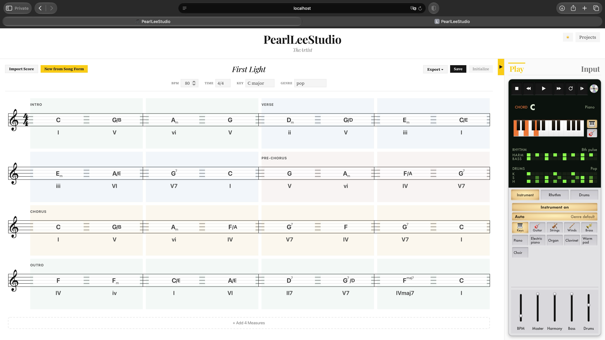
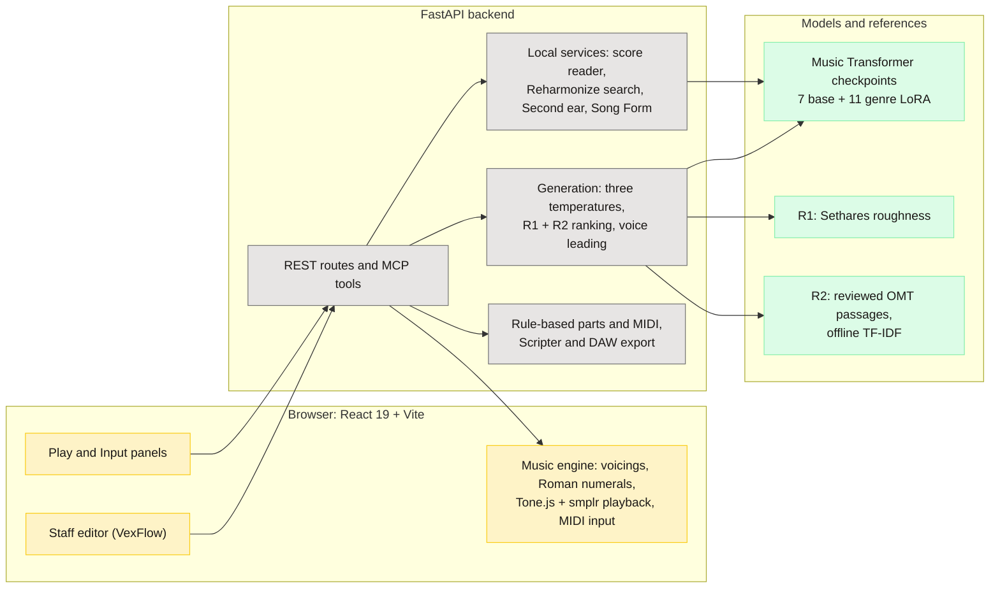
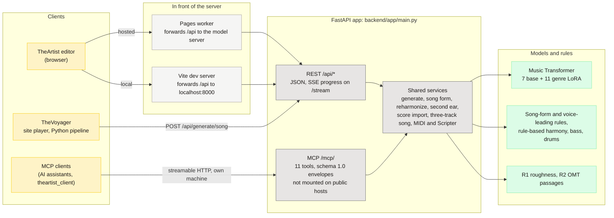
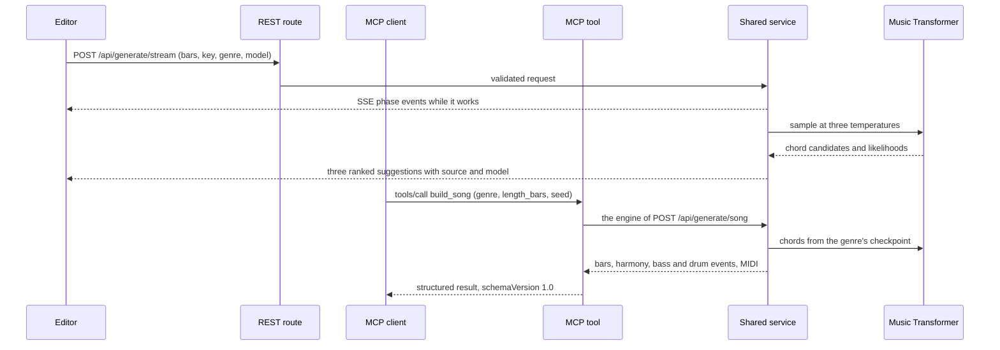

<h1 align="center">TheArtist</h1>

<p align="center">
  <em>A chord-progression composition tool for musicians. Import a score or sketch a progression, reharmonize selected passages and compare alternative harmony in context, grow it into a song form, hear it with accompaniment, and take it to a DAW.</em>
</p>

<p align="center">
  <a href="https://arxiv.org/abs/2605.04998"></a>
  <a href="https://arxiv.org/abs/2606.07334"></a>
  <a href="https://huggingface.co/PearlLeeStudio"></a>
  <a href="https://youtu.be/iSDj4VK9nKc"></a>
  <a href="https://github.com/PearlLeeStudio/TheArtist/blob/main/LICENSE"></a>
  
</p>

<p align="center">
  <a href="https://artist.pearlleestudio.co"><strong>Open TheArtist</strong></a> ·
  <a href="https://www.youtube.com/@StudioPearlLee">Demo videos</a> ·
  <a href="API_SPEC.md">API reference</a>
</p>

<p align="center">
  
</p>

<p align="center"><sub>
The staff editor with Roman numerals and song sections (left) and the Play panel with instrument, rhythm, drums and mixer (right).
<a href="https://youtu.be/iSDj4VK9nKc">Watch the demo on YouTube</a>.
</sub></p>

TheArtist writes chord progressions with its own Music Transformer, a 25M-parameter
model pretrained on about 544K pop progressions and fine-tuned on jazz, and turns them
into an editable arrangement. It treats a progression as a time series and builds song length
and song form into the editor on purpose, so that each new passage can be written with its
place in the song as context ([details](#a-song-as-a-time-series)). Chords are written on a VexFlow staff with two slots per bar, and the
browser computes voicings, Roman numerals and playback.

## Compose, arrange, export

| Step | What you can do |
|---|---|
| Sketch | Enter chord symbols, play a MIDI keyboard, or import a supported score PDF. Review extracted bars before applying them. |
| Develop | Generate chord progressions with the Music Transformer, compare reharmonization candidates, and arrange sections into a song form. |
| Listen and edit | Adjust tempo, meter, voicing, harmony instrument, bass, comping rhythm, drums, and mixer controls. |
| Finish | Save projects, export a score PDF or multitrack MIDI, and continue editing in Logic Pro or another MIDI-capable DAW. |

The editor is designed primarily for desktop use. Imported scores and generated
alternatives remain drafts until you choose to apply them. PDF import reads
supported vector score layouts; it is not a general optical music recognition
system for scans or handwritten notation. Inference uses only TheArtist's Music
Transformer and local score processing, so no model-provider API key is needed.

### What it does

| Feature | What happens |
|---|---|
| **Generate** | Three suggestions for the selected bars from the chosen model, ordered by sensory roughness and theory relevance, then by likelihood in the score when the bars after the selection already hold chords. |
| **Import Score** | A readable vector PDF opens on the staff as editable harmony with its key and meter. |
| **Reharmonize** | Three substitutions for a selected passage, scored in context by the selected Music Transformer. |
| **Second ear** | Names the Generate candidate with the highest conditional chord likelihood, which is not a quality rating. |
| **New from Song Form** | Writes one named section, or extends the sketch to a full form on a genre template. |
| **Play** | 31 harmony sounds, 13 comping rhythms, 15 drum patterns and a mixer over rule-based harmony, bass and drum parts. |
| **Export** | Three-track MIDI, a Logic Scripter script, a score PDF in three themes, and a Mac handoff that opens the MIDI in Logic Pro or shows it in Finder for Ableton Live. |
| **MIDI input** | A chord played on a hardware keyboard goes into the selected slot. |
| **REST and MCP** | The same services over HTTP and eleven MCP tools ([API reference](API_SPEC.md)). |

## Getting started

### Live site

[artist.pearlleestudio.co](https://artist.pearlleestudio.co) runs the editor and its API
with all 18 models, so nothing needs installing to try it.

### Prerequisites

- Node.js 24 or newer (the frontend tests run TypeScript directly with `node --test`)
- Python 3.12+ with [uv](https://docs.astral.sh/uv/)
- About 2.2 GB of disk for all model checkpoints. Inference runs on CPU, and a CUDA GPU is optional.

### Install

```bash
git clone https://github.com/PearlLeeStudio/TheArtist.git
cd TheArtist

uv sync --frozen --directory backend
npm ci --prefix frontend

# Reviewed Open Music Theory passages for R2 (needs network once)
uv run --frozen --directory backend python scripts/setup_omt.py

# Released checkpoints from Hugging Face into ai/checkpoints/ (public, no token)
uv run --frozen --directory backend python ../model/_download.py           # all 18
# uv run --frozen --directory backend python ../model/_download.py --smoke # F1 only
```

Weights and the retrieved theory passages are downloaded separately and are not
stored in the repository. Without checkpoints, Generate returns explicitly labeled
rule-based results, and Reharmonize and Second ear report that the selected model is
unavailable. When you verify inference, check the response's source and model fields:
an HTTP success alone does not show that a model ran.

### Run

```bash
# Terminal 1: backend on port 8000
uv run --frozen --directory backend uvicorn app.main:app --reload

# Terminal 2: frontend on port 5173
npm run dev --prefix frontend
```

Open `http://localhost:5173`. Vite proxies `/api` to the backend. Set
`THEARTIST_WARMUP=1` to load every model at startup. The backend reads process
environment variables and does not load a `.env` file; the
[configuration template](deploy/env.example) lists them, and backend settings are in
[backend/README.md](backend/README.md).

### Hardware MIDI

Chrome supports Web MIDI directly. On macOS, Safari can use the included local
bridge. With Apple's command-line developer tools installed, run:

```sh
python3 tools/midi-bridge/run.py
```

Then choose **Input → MIDI → Enable MIDI**. To install the bridge as a per-user
service that starts at login, add `--install`. Use `--status` to check it.
The bridge also supports local DAW handoff. MIDI download works without the helper.

### Serve a built editor

```sh
npm --prefix frontend run build
THEARTIST_SERVE_FRONTEND=1 THEARTIST_PUBLIC_HOST=1 uv run --frozen --directory backend uvicorn app.main:app --host 127.0.0.1 --port 8000
```

This serves the editor and API from the same origin. Public-host mode disables
local DAW operations, manual warmup, MCP, and private-corpus retrieval. For an
internet-facing deployment, use your own TLS reverse proxy and access controls.
A static frontend host needs an API proxy to the Python server; Pages does not run
PyTorch inference. The included [Pages worker](frontend/public/_worker.js) uses
`BACKEND_ORIGIN` for that proxy.

## How it works

### A song as a time series

TheArtist treats a chord progression as a time series on a bar grid with two chord slots
per bar, and the model predicts each next chord from the chords before it. Song length and
song form are built in on purpose, so that a generated passage gets as much context as
possible: a song has a set number of bars, its sections tell which part of the form a
passage belongs to, and the bars after the passage can already hold chords. The work is
split between the model and the app.

- **The Music Transformer reads the flow.** It is causal and sees the header tokens (key,
  time signature, genre), bar markers and the chords before the passage. It has no token for
  song length or section, and its relative-position attention was chosen so that a ii-V-I
  looks the same in any bar.
- **The section sets the edges.** The section that contains the selected bars, or the one
  picked by hand, adjusts the passage's opening or closing chords and its cadence. When no
  section covers the bars, their place in the whole song decides: a passage that opens the
  song and ends within its first fifth is an intro, one that reaches the last bar an outro,
  one that covers most of the song or ends past 70% of it a chorus, one that ends past 45% a
  bridge, and an earlier one a verse. Bars that cross a section boundary get no song-form
  rule.
  The intro, verse, chorus, bridge and outro rules come from section statistics over the
  679,807 songs of the Chordonomicon release, and the other sections follow common practice.
  For example, 54% of intros open on I, so an intro starts on I, and 19% of bridges end on V,
  so a bridge closes on a half cadence ([song form rules](backend/app/services/song_form.py)).
- **The bars after the passage choose and rank the candidates.** Because the length is
  fixed, the bars after a passage can already hold chords. When they do, each of the three
  temperatures writes four drafts (`THEARTIST_CONTEXT_DRAWS`; fewer for passages over 16
  bars, so a temperature never samples more than 64 bars), each draft is put back into
  the whole score in written order with the section's rules applied, and the draft under
  which the fixed chords that follow are likeliest is kept. The three kept candidates are
  then reordered by the same model's likelihood of the passage and the chords after it. A
  score too long for the model's 256-token window is compared through the nearest bars on
  each side that fit. This is selection and reranking with the causal model, not a
  bidirectional infilling model ([context comparison](backend/app/services/chord_context.py)).
- **Longer pieces start from a length.** New from Song Form plans a form for a target number
  of bars on a genre template before it writes chords, and `POST /api/generate/song` starts
  from a genre and a length in bars.

### Architecture



## Models

TheArtist serves 18 released models: seven base checkpoints (the Phase 0 pop
baseline, the F1 to F5 pop-rehearsal sweep for jazz fine-tuning, and the F1 v2
retrain selected on jazz validation) and eleven genre LoRA adapters trained on the
F1 base. The editor defaults to F1. Jazz is served by F4, pop by F1, and the other
eleven genres by their adapters. Weights are public on
[Hugging Face](https://huggingface.co/PearlLeeStudio) under CC BY-NC 4.0. The
[model guide](model/README.md) and the released model cards give checkpoint
provenance, evaluation definitions and limitations.

The original released F1 checkpoint is weight-identical to Phase 0 because of its
checkpoint-selection behavior. F1 v2 is a separate adapted checkpoint; the eleven
LoRA adapters remain paired with the original F1 base.

The Music Transformer predicts chord symbols. Accompaniment, rhythm, voicing, and
MIDI rendering add rule-based structure around those predictions. Automatic
prediction and constraint scores do not measure listener preference or musical
superiority. Listening evaluation is planned as a separate study to be reported
in a paper.

### Datasets

| Dataset | Songs (used) | Genre | License |
|---|---:|---|---|
| [Chordonomicon](https://huggingface.co/datasets/ailsntua/Chordonomicon) | ~679K | Pop and rock, plus genre-tagged subsets (country, alt, rap, soul, electronic) | CC BY-NC 4.0 |
| [McGill Billboard](https://ddmal.music.mcgill.ca/research/The_McGill_Billboard_Project_(Chord_Analysis_Dataset)/) | ~890 | Pop and rock | CC0 |
| [Jazz Harmony Treebank (JHT)](https://github.com/DCMLab/JazzHarmonyTreebank) | ~1,170 | Jazz | Public |
| [Weimar Jazz Database (WJazzD)](https://jazzomat.hfm-weimar.de/) | ~283 | Jazz | ODbL |
| [JAAH](https://mtg.github.io/JAAH/) | ~113 | Jazz | Research |
| [JazzStandards / iReal-derived](https://github.com/mikeoliphant/JazzStandards) | ~293 | Jazz | Community corpus |
| [Bach 371 chorales (via music21)](https://web.mit.edu/music21/) | 371 | Tonal chorales (the classical adapter's target) | Public domain |

Raw datasets are not redistributed in this repository. Chordonomicon is
CC BY-NC 4.0 and the others have their own terms, so acquire each from the upstream
link above.

### Training

Training is config-driven from `ai/`:

```bash
uv run --directory ai python training/preprocess.py                 # datasets to data/processed/songs.jsonl
uv run --directory ai python training/dataset.py --create-splits    # song-level 80/10/10 splits
uv run --directory ai python training/train.py --config training/configs/phase0_pop_baseline.yaml
uv run --directory ai python training/train.py --config training/configs/ft_jazz_pop50.yaml  # F3, 2.5K pop rehearsal
uv run --directory ai python training/aggregate_results.py
```

## Research

- **Empirical Study of Pop and Jazz Mix Ratios for Genre-Adaptive Chord Generation**
  ([arXiv:2605.04998](https://arxiv.org/abs/2605.04998), v4). Jazz fine-tuning of the
  pop-pretrained model with 0 to 10K pop sequences mixed in. Scored without the three
  header tokens, every run gains 7.2 to 7.8 jazz top-1 points, jazz-only fine-tuning
  loses 1.48 pop points, and the rehearsal volumes from 1K to 10K protect pop nearly
  equally (within 0.11 points), so the smallest volume tested already gives nearly all
  of the measured protection.
- **How Far Can Chord-Symbol Time-Series Adaptation Carry Genre Identity?**
  ([arXiv:2606.07334](https://arxiv.org/abs/2606.07334), v5). Genre adapters on a
  frozen base. Scored without the header tokens, outside Bach chorales LoRA, IA3,
  prefix tuning and full fine-tuning give the same gain, and that gain is about the
  size of a handicap of the frozen base: apart from rock, it never read the target
  genre markers as input in training. Given the pop marker instead, the base comes
  within 0.12 pp of the matched LoRA adapter in every non-chorale genre. Only on Bach
  chorales does adaptation add clearly more (+9.6 pp for the released LoRA adapter).

## Citation

**Accepted to ISMIR 2026 Late-Breaking/Demo (LBD):**
[Where Does Genre Stop Following the Chords? A Fixed-Frame Listening Probe of Bounded Chord-Symbol Genre Identity (TheArtist)](https://ismir2026program.ismir.net/lbd_571.html)

```bibtex
@misc{lee2026chordmix,
  title         = {Empirical Study of Pop and Jazz Mix Ratios for Genre-Adaptive Chord Generation},
  author        = {Lee, Jinju},
  year          = {2026},
  eprint        = {2605.04998},
  archivePrefix = {arXiv}
}

@misc{lee2026genreidentity,
  title         = {How Far Can Chord-Symbol Time-Series Adaptation Carry Genre Identity?},
  author        = {Lee, Jinju},
  year          = {2026},
  eprint        = {2606.07334},
  archivePrefix = {arXiv}
}
```

## API and MCP

| Endpoint | Purpose |
|---|---|
| `POST /api/generate/stream` (`/api/generate`) | Three suggestions for selected bars, with SSE phase events |
| `POST /api/generate/section` (`/stream`) | One named song-form section |
| `POST /api/plan/song` (`/stream`) | Full form on a genre template, written by the selected model |
| `POST /api/reharmonize` | Three contextual substitution patches |
| `POST /api/review/candidates` | Second ear comparison of three candidates |
| `POST /api/import/score` (`/stream`) | Vector-PDF score import |
| `POST /api/export/midi`, `/api/export/scripter` | Three-track MIDI and Logic Scripter script |
| `GET /api/daw/targets`, `POST /api/daw/open` | Local DAW handoff (off on public hosts) |
| `POST /api/generate/song` | Full three-track render from a genre and a length in bars |
| `GET /api/models/list`, `/api/genres/list`, `/api/capabilities` | Models, genres, features and limits |

The full contract is in [API_SPEC.md](API_SPEC.md). MCP is mounted at `/mcp/` with
eleven tools over the same services and is off on public hosts.

### How a call runs





- **One set of services.** The MCP tools call the same code as the routes:
  `build_song` runs `POST /api/generate/song`, `render_midi` renders the bytes of
  `POST /api/export/midi`, and `generate_section`, `plan_song` and `import_score` run
  their routes' code, with the blocking work in a worker thread. A route answers with
  JSON, or with SSE phase events on the `/stream` variants; a tool answers with
  `{"schemaVersion": "1.0", "data": {...}}` as structured content.
- **Hosted and local.** The hosted editor reaches the API through its
  [Pages worker](frontend/public/_worker.js); in development Vite forwards `/api` to
  `localhost:8000`. TheVoyager calls `POST /api/generate/song` on the model server, its
  site player through the site's own worker. MCP is mounted only when
  `THEARTIST_PUBLIC_HOST` is off, so an MCP client talks to a server on its own
  machine; [`backend/theartist_client/`](backend/theartist_client/client.py) is such a
  client.
- **Guarded tools.** `import_score` runs only with `attachmentConfirmed=true`, and
  `export_daw` opens a DAW only with `confirmed=true`, `THEARTIST_MCP_ALLOW_DAW=1` and a
  direct loopback request.

## Source layout

| Directory | Contents |
|---|---|
| `frontend/` | React, TypeScript, VexFlow notation, Tone.js/smplr playback, project state and export UI |
| `backend/` | FastAPI, local inference and analysis, arrangement, import, MIDI export, MCP and Python client |
| `ai/` | Model implementation, training/configuration code, physics, theory retrieval, and selected published analysis |
| `model/` | Model-card sources and download/maintenance tools; weights live on Hugging Face |
| `plugin/logic-scripter/` | Logic Pro Scripter MIDI FX export |
| `tools/midi-bridge/` | macOS CoreMIDI input and local DAW helper |
| `deploy/` | Serving configuration and CPU runtime dependencies |

```text
frontend/
  src/components/ScoreEditor/      staff editor (VexFlow), score import review, song form dialogs
  src/components/RightPanel/       Generate, Reharmonize and song settings, keyboard and fretboard views
  src/components/RightPanel/play/  Play panel: harmony sounds, comping rhythm, drums, mixer
  src/engine/                      chord parsing, voicings, Roman numerals, playback, MIDI, genre tables
  src/store/                       Zustand stores: song, generation, play, plan, reharmonize, review
  public/_worker.js                Pages worker that forwards /api to the model server
backend/
  app/main.py                      FastAPI app: REST routers under /api, MCP at /mcp/
  app/routes/                      one router per feature (generate, plan, reharmonize, review, song, ...)
  app/services/                    inference, song form, reharmonize, review, score import, song builder, exports
  app/models/                      Pydantic request and response contracts
  app/mcp_server.py                eleven MCP tools over the same services
  theartist_client/                Python MCP client
  scripts/                         setup_omt.py, benchmarks and smoke checks
  tests/                           unittest suite
ai/
  training/                        tokenizer, Music Transformer, training and evaluation
  physics/                         R1 roughness
  rag/                             research retrieval pipeline
model/                             model-card sources and download tools
deploy/serve.py, deploy/runtime/   single-origin server and CPU runtime lock
plugin/logic-scripter/             Logic Pro Scripter MIDI FX
tools/midi-bridge/                 macOS CoreMIDI input and DAW helper
```

The public repository, [PearlLeeStudio/TheArtist](https://github.com/PearlLeeStudio/TheArtist),
is a single-commit public source snapshot. It includes the application and
released research code. Private papers, plans, unpublished experiments,
credentials, datasets, and model weights are excluded.

### Checks

```sh
npm --prefix frontend run build
npm --prefix frontend run lint
node --test 'frontend/src/**/*.test.ts'
uv run --frozen --directory backend python -m unittest discover -s tests -t .
```

Tests use authored fixtures. Tests that read unpublished evaluation data are left out
of the public snapshot.

## License

- **Source code:** MIT in the public repository; see its
  [LICENSE](https://github.com/PearlLeeStudio/TheArtist/blob/main/LICENSE).
- **Released weights and derived training artifacts:** CC BY-NC 4.0; see each
  model card. The code license does not grant commercial rights to weights or datasets.
- **Third-party datasets and retrieval sources:** retain their own licenses and
  acquisition requirements. No Berklee book text or private index is distributed.
- **Bundled drum samples:** retain their separate attribution and license in
  [frontend/public/drums/LICENSE.txt](frontend/public/drums/LICENSE.txt).

Created by [Jinju (Pearl) Lee](https://www.linkedin.com/in/pearlmedicilee/) ·
[PearlLeeStudio](https://github.com/PearlLeeStudio).
